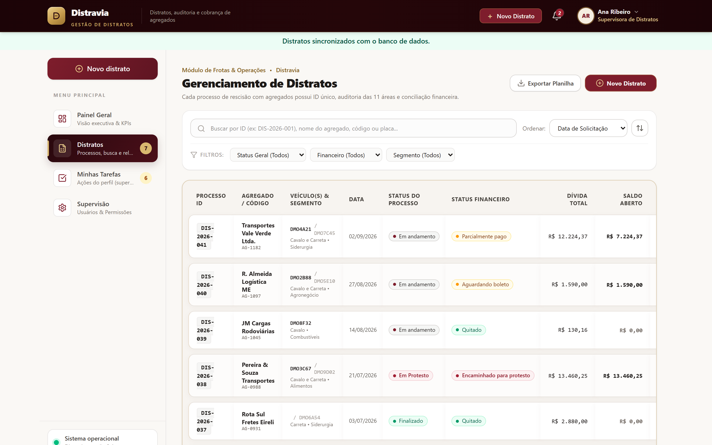
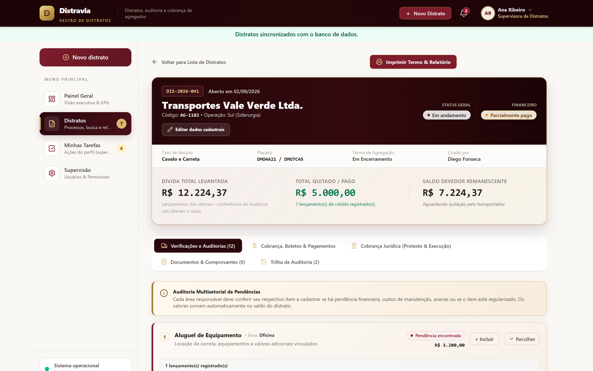
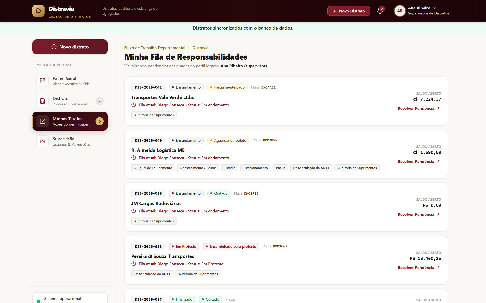
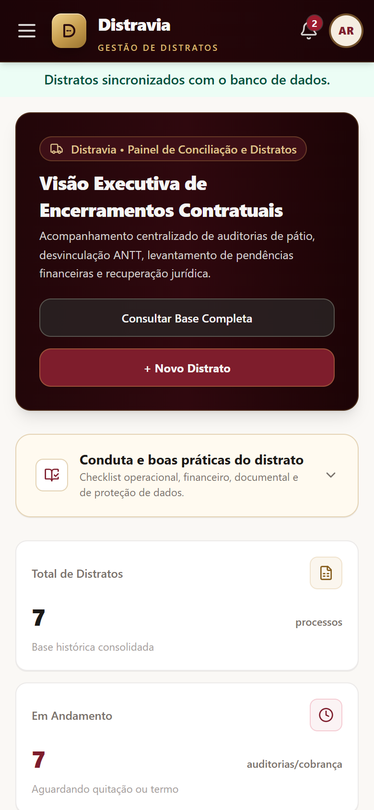

# Distravia — Gestão de Distratos de Agregados e Veículos

Sistema web para conduzir o encerramento de contratos de agregados (transportadores terceirizados) do início à finalização. Reúne em um só lugar as verificações de cada departamento, a apuração da dívida, os pagamentos, a auditoria, os documentos e os encaminhamentos jurídicos.

Feito com React e Supabase, com contas individuais, aprovação pela supervisão e dados compartilhados entre toda a equipe.


## Telas

> As imagens usam dados fictícios.

| Lista de distratos | Detalhe do distrato |
| --- | --- |
|  |  |
| **Fila de tarefas** | **Tela de acesso** |
|  |  |

<p align="center">
  
  <br>
  <sub>Layout responsivo no celular</sub>
</p>

## Funcionalidades

### Fluxo do distrato
- Cadastro do distrato com empresa, veículos, datas de engate inicial e final e documentos opcionais (vários arquivos por categoria).
- Andamento do processo separado da situação financeira: o distrato continua **Em andamento** mesmo quando o financeiro já está **Quitado**.
- Finalização formal pela supervisão após a quitação e a conclusão das verificações, com opção de reabrir e registro no histórico.
- Histórico completo de eventos de cada distrato.

### Verificações por departamento
- Categorias de pendências: manutenção, sinistros, perda de carga, multas, abastecimento, estadia, estacionamento, câmera e rastreador, pneus, aluguel de equipamento e ANTT.
- Vários lançamentos por categoria, com anexos e opção de recolher e expandir.
- Responsável pelo custo (**Agregado** ou **Empresa**). Valores da empresa ficam registrados, mas não entram na dívida do agregado.
- Pneus, câmera e rastreador com quantidade, valor unitário e total calculado.
- ANTT com os estados **Vinculado**, **Em andamento** e **Desvinculado**.

### Financeiro
- Um único pagamento pode quitar várias pendências, com seleção de todas e preenchimento automático do valor.
- Rateio automático de pagamentos parciais entre as dívidas selecionadas.
- Leitura de boletos: o texto é extraído do PDF (PDF.js) ou da imagem (OCR com Tesseract.js) e interpretado por uma Edge Function do Supabase.
- Situação financeira automática: aguardando boleto, a vencer, parcialmente pago, vencido e quitado.

### Auditoria de suprimentos
- Fluxo próprio de achados, separado dos lançamentos dos departamentos.
- Registro de critério, situação encontrada, causa, efeito ou risco, recomendação, criticidade, responsável e prazo.
- Evidência obrigatória para concluir uma auditoria.
- Comparação entre valor lançado, valor auditado e diferença, sem somar conferências à dívida.
- Inclusão de novas pendências encontradas pela auditoria, destacadas como valores extras no resumo financeiro.

### Jurídico
- Conferência de documentos, encaminhamento e efetivação de protesto, e encaminhamento para ajuizamento.
- Comprovantes obrigatórios nos registros jurídicos.

### Painel e relatórios
- Painel geral com indicadores, gráficos e orientações de conduta.
- Lista de distratos com busca, filtros e exportação para CSV.
- Fila de tarefas por departamento, combinada para quem atua em mais de um.
- Relatório para impressão com resumo financeiro, auditoria e campo de assinaturas.
- Notificações de atrasos, vencimentos e quitações.

### Contas e acesso
- Cadastro por e-mail e senha, com confirmação de e-mail e recuperação de senha.
- Novas contas começam pendentes e só acessam o sistema após aprovação da supervisão.
- Perfis e departamentos definidos pelo administrador. Um usuário pode pertencer a vários departamentos.

## Tecnologias

- **Frontend:** React 19, TypeScript, Vite, Tailwind CSS 4, Lucide e Recharts
- **Backend:** Supabase (PostgreSQL, Auth, Storage, Edge Functions e Row Level Security)
- **Leitura de documentos:** PDF.js, Tesseract.js e JSZip

## Como rodar

1. Crie um projeto gratuito em https://supabase.com.
2. No SQL Editor, execute `supabase/schema.sql`.
3. Em **Authentication > Providers > Email**, mantenha o e-mail habilitado.
4. Copie `.env.example` para `.env` e preencha as variáveis (veja abaixo).
5. Execute `npm install` e depois `npm run dev`. O sistema abre em http://localhost:3000.
6. Crie sua conta pela tela do sistema e confirme o e-mail.
7. No SQL Editor, promova sua conta a administrador:

```sql
update public.profiles
set perfil='admin', aprovado=true, ativo=true
where email='SEU_EMAIL';
```

8. Entre novamente. Os próximos funcionários se cadastram pela tela inicial, e o administrador define perfil, departamentos e aprovação na área de **Supervisão**.

### Variáveis de ambiente

| Variável | Obrigatória | Descrição |
| --- | --- | --- |
| `VITE_SUPABASE_URL` | Sim | URL do projeto no Supabase |
| `VITE_SUPABASE_ANON_KEY` | Sim | Chave pública `anon` do projeto |
| `VITE_EMPRESA_NOME` | Não | Nome exibido no sistema (padrão: Distravia) |
| `VITE_EMPRESA_RAZAO_SOCIAL` | Não | Razão social usada no relatório impresso |
| `VITE_EMPRESA_DADOS_CADASTRAIS` | Não | Linha com CNPJ e endereço no relatório impresso |

As variáveis `VITE_EMPRESA_*` permitem usar o sistema com a identidade de qualquer empresa sem gravar esses dados no repositório.

### Leitura de boletos (opcional)

A função `supabase/functions/ler-boleto` interpreta o texto dos boletos. Para ativá-la, publique a função no seu projeto e cadastre o segredo `GEMINI_API_KEY`:

```bash
supabase functions deploy ler-boleto
supabase secrets set GEMINI_API_KEY=sua_chave
```

### Scripts SQL auxiliares

A pasta `supabase/` também traz scripts para habilitar a exclusão de distratos, permitir vários departamentos por usuário, atualizar o perfil de supervisor e limpar dados antigos. Execute cada um uma única vez, quando precisar.

## Publicação

`npm run build` gera o frontend estático na pasta `dist`. Na hospedagem, cadastre as mesmas variáveis do `.env`.

## Segurança

- Nunca exponha a chave `service_role` no frontend.
- Todas as tabelas usam Row Level Security.
- Novas contas começam como `pendente` e sem aprovação.
- A área de Supervisão aparece somente para administradores.

## Estrutura de dados

Cada distrato é salvo como um documento JSONB na tabela `distratos`. Assim, todas as telas e regras trabalham sobre a mesma base, sem depender do `localStorage`. Dados antigos são convertidos automaticamente ao carregar, por exemplo lançamentos de auditoria no formato anterior e categorias duplicadas.

## Próximas etapas

- Permissões por departamento para exclusão de documentos.
- Histórico pesquisável por placa.
- Cancelamento de eventos duplicados sem apagar o histórico.
- Envio automático de e-mails por evento.
